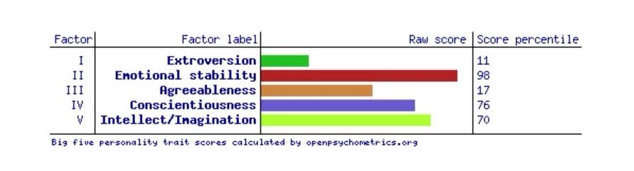

## what is this?

this is a dating documentation. it is like a cv, but for dating, where a person (in this case, me) tells you the necessary information so that you can quickly scan and filter me out (if i’m not who you are looking for)

this document isn’t here to replace getting to know each other. it’s just a shortcut through the repetitive parts so we can spend more time on the interesting ones

## about me

hi! i’m ted, and i’m:

- a straight male

- 27 years old

- a software engineer

- living in hcm city

### my big five

big five is like mbti, but with scientific evidence

here is mine:

as you can see, i:

- am a hardcore introvert

- like discussions and feel okay with disagreements

- like to plan! i even plan my death 💀

- like anything new. new food, new coffee shop, new ideas, new books

### what talking with me is like

- i do not talk or care about showbiz/celebrities

- i enjoy talking about ideas/abstractions

- i like understanding why people think what they think and how they arrived at their conclusions

- i am heavily curious, so it is best if you also enjoy the wonderment of the world as much as i do

- i like to talk about many topics at the same time

### i like to read

i spend most of my time on reading. i read sci-fi, psychology, epistemology, and all other kinds of things

the following are my fav authors:

https://tednguyen.me/#read

### i like to write

i also write, mainly about thinking, human connections, efficiency, and rationality:

https://tednguyen.substack.com/

## if you have the following traits, we are likely a match

you:

- read

- see that life is more than doing what other people are doing, just because that is the way it is

- are curious about everything and never feel like your current understanding of the world is enough

- already are, or are in the process of, figuring yourself out

## signs that you are not for me

you:

- do not find yourself in the above section

- you are catholic. no offense, really. it is just not what i am seeking

## my life goals

my goals are non-specific: i want to learn, read, build, and write more fun things

my non-goals are a lot more specific:

## my non-life-goals

### i do not want kids

it is not that i hate kids. it is just that i do not like kids enough to make the trade-offs. to me, kids are just people at a different stage of life

### i do not want to buy real estate in vietnam

it is just that i do not want to play a game where everyone loses but keeps playing because they are afraid of fomo. i prefer stock investment

### i do not want to buy cars in vietnam

seriously, cars, in this economy, in this city?

<!-- section-note -->

---

i know these are very hard to negotiate, so it is better if we are aware of the differences in goals from the beginning

## more of why i write this

- because it is fun

- because i find it boring and time-consuming to keep asking and answering the same kinds of questions every time

read more:

https://www.astralcodexten.com/p/in-defense-of-describable-dating

## more about me

### what i do recently

- i am trying to limit my social media usage. i used to limit it by ‘total time use’, but i am starting to see limiting the ‘total open times’ a day is a much more efficient way

- i am starting to read about modern philosophers. harder than i thought. but it seems like a fun thing to spend time on

- i am learning to trek. i have only been on 2 routes, but i feel like this is something i will spend more time on

- i am starting to join more reading groups and seeing more people. it wasn’t as hard as i thought. it feels very natural to be around people who are like you

### my relationship with traveling

i have mixed feelings for traveling. there are times when i solo travel for months and feel like this is the way i should live, and there are also months when i love staying at home and read and write and do everything around my optimized environment (i mean my room)

### how i spend

since i mostly read and write, my hobbies don’t cost much

for those that i spend, like clothes or digital devices, i prefer to buy little but good ones. i focus on the functionality/portability/durability of them more than how nice they look or how cool they are

### how am i in groups

you will see me as silent and observant. i only talk when there are statements that i truly believe will bring positive net value to the group. otherwise, i am fine with just listening to the most interesting people in the group

### oh and i dropped out of university

i loved learning in elementary school, when the things i studied felt tangible and made sense to me

by the time i reached middle school, i no longer saw the point, so i lost interest

quitting university and realizing that i could make learning fun all by myself was one of the defining milestones in my life
